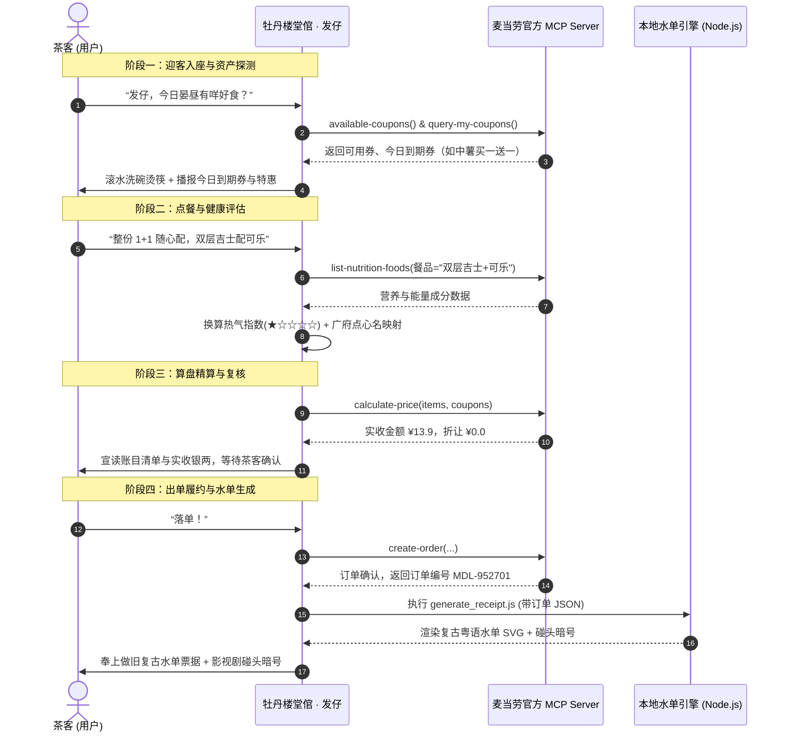

# 麦当劳官方 MCP 集成文档 (MCP Integration Guide)

> **项目名称**：牡丹楼 · 叹茶堂倌 (Mcd-Mudanlou)  
> **MCP Server**：麦当劳中国官方 MCP 开放服务平台 (`mcd-mcp`)  
> **服务协议**：Remote Streamable HTTP / Server-Sent Events (SSE)

---

## 📖 1. 概述与集成背景

麦当劳中国官方推出的 MCP（Model Context Protocol）服务平台（[`open.mcd.cn`](https://open.mcd.cn)），通过标准化的 MCP 协议向 AI Agent 开放了覆盖**菜单点餐、卡券优惠、营养测算、门店定位与订单履约**等 30 余个原子工具能力。

本项目《牡丹楼 · 叹茶堂倌》基于麦当劳官方 MCP Server，采用 **Agent Skill 沉浸式人设封装 + 垂直领域决策链 + 离线矢量水单引擎** 的架构设计，将冰冷的快餐 API 转换为具有浓郁广府文化的百年茶楼“叹茶”体验。

---

## 🌐 2. 麦当劳官方 MCP Server 架构

```
┌─────────────────────────────────────────────────────────────┐
│                       Client Agent                          │
│        (Antigravity / Cursor / Trae / Claude Code)          │
│                                                             │
│   ┌─────────────────────────────────────────────────────┐   │
│   │   牡丹楼 Skill (堂倌人设 + 粤语黑话 + 决策调度)    │   │
│   └──────────────────────────┬──────────────────────────┘   │
└──────────────────────────────┼──────────────────────────────┘
                               │ Streamable HTTP / SSE
                               │ Bearer <YOUR_MCP_TOKEN>
                               ▼
┌─────────────────────────────────────────────────────────────┐
│                 麦当劳中国官方 MCP Server                   │
│                  https://mcp.mcd.cn/sse                     │
│                                                             │
│   ┌───────────────┐ ┌───────────────┐ ┌─────────────────┐   │
│   │ 菜单与餐品域  │ │ 卡券与资产域  │ │ 计价与履约域    │   │
│   ├───────────────┤ ├───────────────┤ ├─────────────────┤   │
│   │ 营养健康域    │ │ 门店与定位域  │ │ 积分商城域      │   │
│   └───────────────┘ └───────────────┘ └─────────────────┘   │
└──────────────────────────────┬──────────────────────────────┘
                               │ 内部 RPC / Gateway
                               ▼
┌─────────────────────────────────────────────────────────────┐
│             麦当劳生产业务中台 (POS / 会员 / 履约)          │
└─────────────────────────────────────────────────────────────┘
```

### 核心通信规范：
* **服务端地址**：`https://mcp.mcd.cn`（SSE 端点：`/sse`）
* **协议类型**：`streamablehttp` / `http`（基于 Server-Sent Events 流式通道）
* **鉴权方式**：HTTP 请求头携带 `Authorization: Bearer <YOUR_MCP_TOKEN>`
* **账号绑定**：Token 与用户大陆手机号绑定，实时同步该账户的麦麦省卡券、麦金卡权益、积分资产及历史订单
* **速率限制**：单 Token 频控最大 **600 次/分钟**

---

## 🛠️ 3. 实际调用的核心 MCP 工具矩阵

在本项目中，麦当劳官方 MCP 提供的工具根据业务阶段被模块化调度：

### 3.1 卡券与资产域（薅羊毛与资产盘点）
| MCP Tool | 工具说明 | 牡丹楼业务落地场景 |
| :--- | :--- | :--- |
| `available-coupons` | 查询可领取的麦麦省优惠券 | 堂倌迎客时，主动推荐领取消暑/折扣神券（如买一送一、免费脆薯饼） |
| `query-my-coupons` | 获取用户卡包已有的优惠券资产 | 盘点茶客卡包，优先挖掘**“今日即将到期”**的券，杜绝优惠浪费 |
| `query-store-coupons` | 查询指定门店可核销的卡券 | 选定就餐门店后，精确校验可用卡券资格 |
| `auto-bind-coupons` | 批量自动领券绑定到账 | 一键将全网通用优惠打入用户卡包，免除手动领券繁琐 |

### 3.2 菜单与餐品域（点心名点化映射）
| MCP Tool | 工具说明 | 牡丹楼业务落地场景 |
| :--- | :--- | :--- |
| `query-meals` | 获取门店实时在售菜单列表 | 查询到店自取(orderType=1)或外送(orderType=2)餐品及商品 code |
| `query-meal-detail` | 查询单品规格与客制化选项 | 支持粤语黑话客制化（走冰、飛生菜、多醬、飛邊對切） |
| `query-meal-assistance`| 智能配餐助手 | 提供团餐或特定预算门槛下的智能组合方案 |

### 3.3 算价、营销与活动域（老广精明算盘）
| MCP Tool | 工具说明 | 牡丹楼业务落地场景 |
| :--- | :--- | :--- |
| `calculate-price` | 精确计算折后实付总额 | 在下单前精确核算 1+1 随心配、卡券减免、满减折让后的实付银两 |
| `campaign-calendar` | 营销活动日历 | 自动识别今日活动（如周一会员日触发“開倉濟世，落單送香辣鳳羽”） |
| `query-promotions` | 团餐/大单促销满减规则 | 针对多人聚餐、下午茶等场景自动应用最优折扣规则 |

### 3.4 营养与健康域（老中医热气监控）
| MCP Tool | 工具说明 | 牡丹楼业务落地场景 |
| :--- | :--- | :--- |
| `list-nutrition-foods` | 查询餐品卡路里、脂肪、钠及营养素 | 计算餐品**“熱氣指數”（1~5星）**，对重度油炸给出老广老中医降火建议 |

### 3.5 门店、履约与订单域
| MCP Tool | 工具说明 | 牡丹楼业务落地场景 |
| :--- | :--- | :--- |
| `query-nearby-stores` | 查询附近门店列表与营业状态 | 确定就餐老字号分号（门店编码 storeCode）与得来速车道支持 |
| `create-order` | 提交订单至麦当劳收银系统 | 经茶客二次复核后正式落单，返回取餐码与支付凭证 |
| `query-order` / `order-list` | 订单状态与历史追踪 | 查询点单制作进度（取餐编号、备餐状态） |
| `cancel-order` | 取消未支付/异常订单 | 茶客改主意或重算时的无痛撤销 |

---

## 🔄 4. 业务端到端调用时序 (End-to-End Workflow)



---

## 💎 5. 核心业务与技术价值

### 1. 消除快餐“机器味”，赋予高情绪价值
传统的点餐 Bot 往往机械列出 SKU，交互生硬。本项目将技术协议沉淀到底层，将表面交互重塑为上下九百年老茶楼跑堂的“人情味”：
* **客制化黑话翻译**：“去冰”变为“走冰”，“不加生菜”变为“飛生菜”，“双层吉士堡”变为“雙層芝士金錢牛包”。
* **文化共鸣**：配合港剧与老广经典台词，让一次普通的午饭消费变成一段解压、有趣的对话体验。

### 2. 精准的极致省钱策略 (AI 决策大脑)
借助 `available-coupons`、`query-my-coupons` 与 `calculate-price` 的三级联动：
* **抢救临期券**：主动探测用户账户中当天即将作废的高价值卡券，提醒用户使用；
* **组合数学寻优**：在预算有限场景下，自动推导 1+1 随心配、买一送一拼单、积分兑换的最优搭配方案，真正做到“大件夹抵食”。

### 3. 平衡美味与健康的“老中医热气监控”
快餐高油高糖常引发饮食顾虑。通过 `list-nutrition-foods` 实时获取热量与营养指标，引入老广传统的“热气指数（1~5星）”量化体系：
* 点炸鸡、大薯条时主动触发老妈式碎碎念，建议搭配无糖茶饮或走冰零度；
* 点板烧、玉米杯等健康单品时主动给予夸奖，引导科学合理的膳食平衡。

### 4. 离线零依赖视觉沉淀与社交传播裂变
点单完成后，自动化调度本地矢量生成器生成具备做旧纹理、撕边锯齿与红色银讫印章的 **全粤语复古水单 SVG**：
* 附带随机经典影视剧碰头暗号（如*“你肚唔肚餓？我煮碗麵畀你食啊？”*）；
* 成为用户在社交媒体（朋友圈、小红书等）极具吸引力的晒单素材，完成从“工具服务”到“内容裂变”的闭环。

---

## 📌 6. 开发者快速排查 (FAQ)

* **Q: 为什么调用 `query-meals` 提示需要 storeCode？**  
  **A**: 麦当劳不同门店在售餐品与价格存在区域差异，请先通过 `query-nearby-stores` 获取当前地理位置最近的 `storeCode` 与 `beCode`。
* **Q: 为什么卡包查到的券在下单时无法使用？**  
  **A**: `query-my-coupons` 仅代表用户账户资产，未做门店及就餐方式校验；正式下单前建议调用 `query-store-coupons` 校验当前门店是否支持核销该券。
* **Q: 官方 MCP 的 Token 有效期多久？**  
  **A**: 麦当劳开放平台申请的专属 Token 为长期有效，如需重置可在 [open.mcd.cn/mcp](https://open.mcd.cn/mcp) 控制台重新激活生成。
