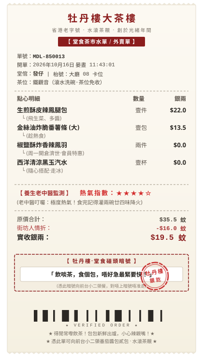

# 🫖 牡丹楼 · 叹茶堂倌 (Mcd-Mudanlou)

> **当麦当劳官方 MCP 遇上广府百年老字号“牡丹楼”**  
> 一款专为打工人打造的沉浸式广式茶楼风麦当劳点餐、省钱与养生监控 Agent Skill。

<p align="center">
  
</p>

---

## 🌟 项目简介

在广东，“麦当劳”因粤语口音和出租车司机的经典段子，常被街坊戏称为“省港老字号茶楼——**牡丹楼**”。

本项目基于 **麦当劳中国官方 MCP Server**（[`M-China/mcd-mcp-server`](https://github.com/M-China/mcd-mcp-server)），将其底层的菜单查询（`query-meals`）、卡券优惠（`available-coupons`）、营养分析（`list-nutrition-foods`）以及下单履约（`create-order`）等 30 余个原子工具，深度包装为**广府传统早茶叹茶体验**。

你面对的不再是一个冷冰冰的 AI，而是广州上下九百年茶楼里的资深跑堂小二——**“发仔”**！他手提铜壶、腰插算盘、高喊“位位滚水，借借唔该”，用精明的老广算盘帮你薅尽优惠，并在点单完成后自动“啪”地甩出一张**做旧复古的全粤语茶楼水单**！

---

## ✨ 核心特色

### 1. 🎭 沉浸式老茶楼人设与黑话交互
* **堂倌礼仪**：开场主动“开水烫碗洗筷子”，一口地道粤语/广普迎客入座；
* **客制化黑话**：
  * 去冰 ➡️ **走冰**
  * 不加生菜 ➡️ **飛生菜**
  * 多加酱 ➡️ **多醬**
  * 汉堡对切 ➡️ **飛邊對切**

### 2. 📜 菜品茶楼名点化
所有西式快餐全部换算为传统茶楼点心卡：
* **麦辣鸡腿堡** ➡️ `生煎酥皮辣鳳腿包`
* **巨无霸** ➡️ `雙層金錢厚切牛魔包`
* **麦辣鸡翅** ➡️ `椒鹽酥炸香辣鳳羽`
* **薯条** ➡️ `金絲油炸脆番薯條`
* **1+1 随心配** ➡️ `一盅兩件·街坊恩物`
* **零度可乐** ➡️ `無糖黑玉汽水（清涼降火）`

### 3. 🧮 老广精明算盘（极致省钱算法）
* **穷鬼套餐拼单**：调用 `calculate-price` 与 `available-coupons` 自动计算 1+1 随心配、组合满减、积分清零的最优解；
* **开仓济世提醒**：结合 `campaign-calendar` 活动日历，每周一准时提醒“今日周一开仓济世，落单免费送香辣凤羽（鸡翅）！”。

### 4. 🍵 怕上火“熱氣指數”老中医监控
* 调用 `list-nutrition-foods` 获取脂肪、卡路里与钠含量，动态计算 **1~5 星“熱氣指數”**；
* 如果你点了炸鸡+大薯条，发仔会化身碎碎念阿妈：“哇老细！呢单嘢热气到喉咙喷火，下昼记得灌两碗廿四味降火！”并建议你将高糖饮料换成无糖乌龙或零度。

### 5. 🧾 朋友圈晒单神器：全粤语复古水单
* 采用独立矢量生成引擎（纯 Node.js，零第三方图形依赖）；
* 呈现**做旧泛黄热敏纸底色、顶部/底部锯齿撕边、传统点阵字排版、红色【牡丹樓·銀訖】做旧印章**；
* **经典港剧/影视剧碰头暗号**：随机生成《少林足球》《扫毒》《义海豪情》《外来媳妇本地郎》经典台词（如：`「 耶穌都留佢唔住，我話嘅！ 」`、`「 飲啖茶，食個包，唔好急！ 」`、`「 食屎啦，梁非凡！ 」`）。

---

## 📁 目录结构

```text
mcd-mudanlou/
├── SKILL.md                          # 核心技能规范（堂倌人设、黑话对照、MCP调用与出单规则）
├── references/
│   ├── menu_mapping.json             # 麦当劳 ➡️ 广府茶楼点心双向映射字典
│   └── cantonese_memes.json          # 影视剧台词与老广经典暗号词库
├── scripts/
│   └── generate_receipt.js           # 复古水单生成脚本 (Node.js 矢量生成器)
└── output/
    └── receipt_xxxx.svg              # 自动渲染生成的水单票据图片
```

---

## 🚀 麦当劳官方 MCP 配置指南

> [!IMPORTANT]
> 麦当劳中国官方提供的 MCP 是**远程托管服务 (Remote Streamable HTTP)**，并非本地 `npx / stdio` 进程，因此配置时需要使用 `streamablehttp` 或 `http` 协议接入官方服务器。

### 第一步：获取你的专属 MCP Token
1. 访问麦当劳 MCP 开放平台：[https://open.mcd.cn/mcp](https://open.mcd.cn/mcp)（文档中心：[https://open.mcd.cn/mcp/doc](https://open.mcd.cn/mcp/doc)）；
2. 点击右上角【登录】，使用你的**中国大陆手机号**登录（*该手机号绑定的即为你点餐、查券、消耗积分的麦当劳会员账号*）；
3. 登录后进入【控制台】，点击【激活】按钮，阅读并同意服务协议；
4. 申请成功后，一键复制生成的专属 **MCP Token**（*Token 仅展示一次，请妥善保管*）。

### 第二步：在 AI 客户端中配置 MCP Server

将以下 JSON 填入你客户端的 `mcp.json`（例如 Cursor、Antigravity、Cherry Studio、Trae 等）：

```json
{
  "mcpServers": {
    "mcd-mcp": {
      "type": "streamablehttp",
      "url": "https://mcp.mcd.cn",
      "headers": {
        "Authorization": "Bearer YOUR_MCP_TOKEN"
      }
    }
  }
}
```

> **各客户端适配贴士**：
> * **Claude Code**：若对协议类型有特定要求，可配置为：
>   ```json
>   {
>     "mcpServers": {
>       "mcd-mcp": {
>         "type": "http",
>         "url": "https://mcp.mcd.cn/mcp-servers/mcd-mcp",
>         "headers": {
>           "Authorization": "Bearer YOUR_MCP_TOKEN"
>         }
>       }
>     }
>   }
>   ```
> * **CLI / 环境变量模式**：如果使用命令行客户端，支持在 `.env` 中指定：
>   ```env
>   MCD_MCP_TOKEN=你的_mcp_token
>   MCD_MCP_URL=https://mcp.mcd.cn
>   ```
> * **频率限制**：官方限制单 Token 最大请求频率为 **600 次/分钟**。

---

## 💬 技能安装与对话使用

### 1. 安装 Skill
将 `mcd-mudanlou` 文件夹放置在你的 Agent Skills 目录下（例如项目技能根目录或系统的全局 skills 路径下）。

### 2. 唤醒与点餐
* **自然语言（隐式识别，推荐）**：
  > “中午想吃麦当劳，预算 30，帮我看看怎么配”  
  > “发仔，今日晏昼有咩好食？”  
  > “减脂期，热量控制在 450 卡以内，帮我点个牡丹楼”
* **显式指定**：
  > “调用牡丹楼技能，发仔出嚟接客！”

---

## 🛠️ 独立测试水单生成器

无需联网，也可以随时在本地运行水单生成脚本测试效果：

```bash
# 生成默认示例小票
node scripts/generate_receipt.js

# 自定义订单数据生成
node scripts/generate_receipt.js --data '{
  "orderId": "MDL-888888",
  "table": "大廳 08 卡位",
  "waiter": "發仔",
  "teaType": "普洱（滾水洗碗）",
  "items": [
    { "name": "生煎酥皮辣鳳腿包", "note": "飛生菜、多醬", "qty": "壹件", "price": 22.0 },
    { "name": "椒鹽酥炸香辣鳳羽", "note": "會員開倉濟世", "qty": "兩件", "price": 0.0 }
  ],
  "heatLevel": 4,
  "heatComment": "熱氣逼人！記得飲涼茶",
  "discount": 10.0,
  "pickupCode": "飲啖茶，食個包，唔好急！"
}' --out ./my_receipt.svg
```

---

## 🍵 广府文化彩蛋：“牡丹楼”的由来

> “师傅，广州边度有平靓正嘅老茶楼啊？”  
> “去‘牡丹楼’啦！环境好有冷气，又平又快！”  
> ——外地游客满怀期待打车前往，抬头一看：一个金灿灿的黄色大 **“M”**。

在广东，“麦当劳（Mak-Dong-Lou）”在快语速和广普口音下听起来神似“牡丹楼”，加上老广对叹茶和一盅两件的执念，逐渐演化为风靡粤语圈的都市传说与官方快闪活动。

---

## 📜 许可证

本项目遵循 MIT 开源许可证。
各品牌商标及接口归麦当劳所有，本项目纯属文化创意与技术集成实践。水滚茶靓，得闲常嚟饮茶！
